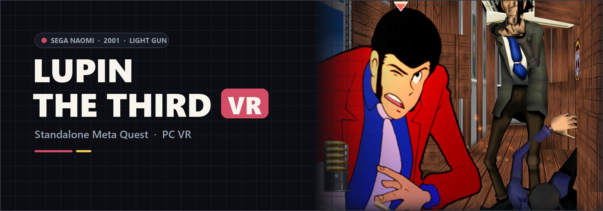

<div align="center">



# Death Crimson OX VR
### SEGA NAOMI Light-Gun Action · Standalone Meta Quest & PC VR

[](https://github.com/vr4all-standalone/death-crimson-ox-vr/releases/latest)
[](#quest-setup)
[](#bring-your-own-game)

**[⬇️ Quest APK](https://github.com/vr4all-standalone/death-crimson-ox-vr/releases/latest/download/death-crimson-ox-vr-quest.apk)** · **[🖥️ PC VR ZIP](https://github.com/vr4all-standalone/death-crimson-ox-vr/releases/latest/download/death-crimson-ox-vr-pcvr.zip)** · **[🎮 Controls](#controls)**

[Checksums](https://github.com/vr4all-standalone/death-crimson-ox-vr/releases/latest/download/SHA256SUMS.txt) · [All releases](https://github.com/vr4all-standalone/death-crimson-ox-vr/releases)

**[🌐 VR4ALL — Standalone VR Mod Installer](https://github.com/vr4all-standalone/vr4all-standalone-vr-mod-installer)**

</div>

---

## Overview

**Death Crimson OX VR** brings the arcade light-gun game to standalone Meta Quest and
Windows PC VR. The original NAOMI game runs in Flycast; its scenes are reconstructed
in stereo, and your tracked controllers become the light guns. Two players can play
with one headset, using a controller for each player.

It carries over the menus and controller features of
**[Confidential Mission VR](https://github.com/vr4all-standalone/confidential-mission-vr)** and
**[Lupin the Third VR](https://github.com/vr4all-standalone/lupin-the-third-vr)**.
These projects build on **[mikermak's VR fork of Flycast](https://github.com/mikermak/hotd2-vr)**,
itself based on **[Flycast](https://github.com/flyinghead/flycast)**.

**Status: experimental.** Builds and desktop simulator checks are documented below.
Physical headset performance, tracking, comfort and full later-stage coverage remain
unverified.

## What it includes

- Stereo game reconstruction with tracked head movement and controller aiming.
- The game's own soldier pistol, prepared locally from your original cartridge on first launch and reused from a validated cache.
- Two-player gun assignment, solo either-trigger hand transfer, two reload modes, laser and haptic levels.
- A paused VR menu with gun choice/angle, world size, panel distance, wider view, How to play, recenter and Quit.
- Credited Arcade gun and Zapper models, custom GLB guns/controllers, and a built-in fallback.
- A separate Quest app and setup screen; it can coexist with the other VR ports.

## Bring your own game

This release supports **NAOMI Japan Rev A**, resolved as `deathcoxj`:

```text
Download/
  deathcoxj.zip
  naomi.zip
```

The game ZIP contains `epr-23524a.ic22` (4 MiB, CRC `b60e113e`) and all ten `mpr-23514.ic1` through `mpr-23523.ic10` chips (8 MiB each). A supported NAOMI BIOS can be inside the game ZIP or in `naomi.zip` beside it. **No CHD is needed.** Setup validates actual lengths and CRCs, including the BIOS; the standalone native loader also verifies every game chip before emulation.

An older merged archive may be called `deathcox.zip` while containing Japan Rev A. Keep the original and make a separate complete copy called `deathcoxj.zip`. Renaming alone cannot make incompatible contents valid. Current USA `deathcox` and original Japan `deathcoxo` programs are unsupported.

No game, BIOS or extracted native gun data is included in the downloads or source.

## Quest setup

1. Install through [VR4ALL](https://github.com/vr4all-standalone/vr4all-standalone-vr-mod-installer), or sideload the Quest APK with your usual installer.
2. Put your verified ZIPs in the headset's `Download` folder. VR4ALL transfers them to the canonical paths above and enables file access.
3. Open **Death Crimson OX VR** under Unknown Sources and grant file access if requested. Its setup screen enables Play when the original set and BIOS pass validation.
4. First launch prepares the native pistol from those files. B or Y skips it for this session; the Arcade gun remains available. The next game launch can retry.

Application ID: `com.vrlightgunhub.deathcrimsonox`.

## PC VR setup

1. Extract the PC VR ZIP into its own folder.
2. Create `roms` beside `flycast.exe`, and add your `deathcoxj.zip` and optional separate `naomi.zip` there.
3. Connect your headset to the active OpenXR runtime, such as Quest Link, SteamVR or Virtual Desktop.
4. Run **Play Death Crimson OX.cmd**. The first-run model and settings stay with this portable copy.

## Controls

The **Two players** setting defaults to **P1 left / P2 right**. Choose **P1 right / P2 left** to reverse it. In single-player, either trigger moves the gun to that hand and fires P1, independently of this two-player setting.

| Control | Default action |
| --- | --- |
| Either trigger, single-player | Move the gun to that hand and fire P1 |
| Left X, solo | P2 Start / join |
| Right A, solo | P1 Start |
| Y / B | Reload; either in solo play, each player's own in two-player play |
| Left Menu | Pause / VR settings |
| Left stick click | Recenter |
| Right stick click | Toggle laser |
| Grip + stick up/down | World size |
| Grip + stick left/right | Gun size |

Solo Start roles match Confidential Mission: A/right starts P1 and X/left joins P2. Joining applies **Two players** immediately: P1 left / P2 right by default, or the reverse when selected. With two players in, each hand's Start belongs to its assigned player; a held press keeps its original player until released, including through joining, leaving and swapping. When joining is unavailable, X does not start P1. Held triggers must be released before firing after joining, leaving, swapping, restarting or preparation.

**Shoot off-screen** is the default reload mode; **Point off-screen** is selectable. Native ammo refills caused by damage remain part of the original game's behavior. Controller labels explain the active assignment and solo trigger behavior.

## First-run native pistol

The native option is the complete **soldier pistol** in the game's E410 model, with its original `MSGUN01.PVR` texture. It is not the protagonists' mythical Crimson weapon. The earlier attract-only search missed it; direct examination of the owned cartridge filesystem established the complete geometry.

Extraction happens locally from the verified cartridge data, with no gameplay autoplay or external asset download. It produces the game-specific `gun-dc-pistol.bin` cache: a complete 52-triangle, textured pistol at a 0.24 m barrel-axis length. Reuse checks its format, counts, texture integrity and geometry. Missing or corrupt caches are rebuilt; B/Y skip and read/write failure keep the Arcade fallback, without retrying when a paused game resumes. A new launch can retry.

The menu also offers the credited Arcade gun, Zapper and compatible custom GLB models. See the [native model investigation](hotd2-vr/notes/death-gun-findings.md) for the measured source and validation rules.

## Validation and builds

See the [validation record](hotd2-vr/notes/death-validation.md), [native-state findings](hotd2-vr/notes/death-native-state.md), and [physical headset checklist](hotd2-vr/notes/death-headset-checklist.md). Simulator evidence does not establish physical headset results.

Windows: `hotd2-vr\build-win.cmd Release ON`. Quest: `hotd2-vr\build-quest.cmd` with a configured JDK and Android SDK. Research builds can explicitly disable the standalone policy; distributed builds enable it. `hotd2-vr\package-release.ps1` requires clean source and verifies the APK identity/signature, native policy, embedded commit, licenses, model credits and archive exclusions.

The release contains only `death-crimson-ox-vr-quest.apk`, `death-crimson-ox-vr-pcvr.zip` and `SHA256SUMS.txt`. Generated gun caches, ROMs, BIOS, private signing material and research captures are excluded. The published tag names the corresponding source commit. Releases follow the preceding ports' locally verified build workflow; inherited upstream CI/upload jobs are disabled on this standalone repository.

## Credits and license

Flycast by flyinghead and contributors; mikermak's [HOTD2 VR/OpenXR work](https://github.com/mikermak/hotd2-vr); Confidential Mission VR and Lupin VR adaptations. Preserve `LICENSE`, `README.flycast.md` and distributed software/model notices. Bundled models retain their own licenses and credits. The native game pistol is generated from each player's own game and is not redistributed.

The [banner provenance](hotd2-vr/assets/death-banner.md) identifies the promotional artwork; it is not a headset screenshot. This unofficial project is not affiliated with Ecole, Sammy, Sega or Meta.

### Player assignment regression

Run `powershell -NoProfile -File hotd2-vr/player-assignment-test.ps1` on a Windows development machine with Visual Studio C++ tools. It compiles the production hand policy, Start ownership, join/leave and menu code and checks both layouts against Confidential Mission behavior.

## Quest Start and Service buttons

Play launches immersive VR from passthrough or a virtual Quest Home. After loading,
**A** starts P1; **X** requests P2 where supported, after P1 has started. The second
gun appears only after native P2 acceptance. Two-player Starts follow the saved hand
assignment. Survivor retains its native single-player controls.

To enter Service, open the in-game VR menu and choose **Open Service Menu**, directly
above **Quit**. Holding A does not open Service. Normal controller buttons do not
enter the arcade menu; the row is available after initial loading, offline with VR guns enabled.

Inside standard NAOMI Service, **X = Next** and **tap A = Select**. The purple guide appears below
the native menu. Choose the native **EXIT** option to restart the game and restore
normal controls automatically; there is no B step. Leaving a submenu keeps Service
navigation available. Aiming, triggers and directions remain usable for native tests.

Held A/X inputs require release after opening, settings or focus recovery. Native
main-game boot and new game/session resets clear Service controls. Existing external
keyboard/gamepad cabinet controls remain available.

Ninja Assault and Survivor use Namco's native operator menu: **X = Down**,
**A = Enter**, with the stick also available for Up/Down. While it is open,
the same VR menu row reads **Exit Service Menu** and sends the native return
command after resuming. The guide and ordinary gameplay controls restore
automatically after the game leaves its operator menu. A alone never opens or
closes Service during ordinary gameplay.
